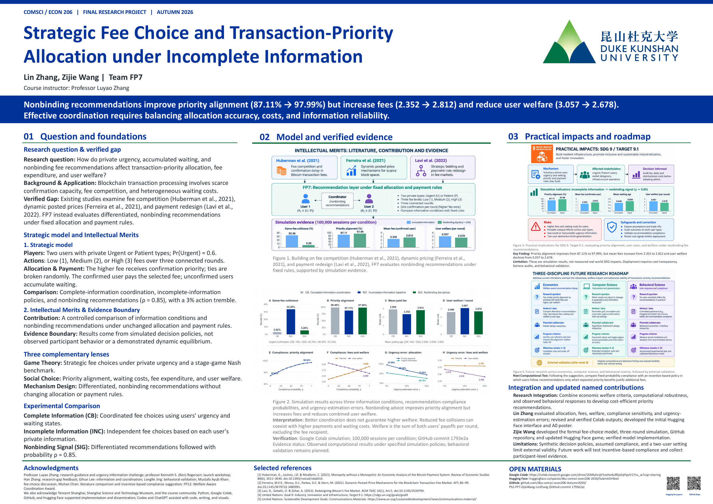

[Open the current A0 poster PDF](poster/Final-FP7-ZijieLin-A0-Poster.pdf)

# Strategic Fee Choice and Transaction-Priority Allocation under Incomplete Information

**Two users, three connected rounds, and Low / Medium / High fees.**

[Repository notebook](notebooks/dynamic_fee_choice.ipynb) · [Open Colab](https://colab.research.google.com/drive/1E5NDNUU62rHPwp9UCG9oEHXplz3PG9EJ?usp=sharing) · [Hugging Face behavioral interface](https://huggingface.co/spaces/dku-comsci-econ206-2026/SubmitOrWait)

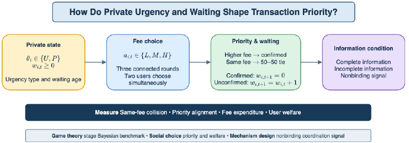

*Research design: private urgency and waiting, three-round fee choice, priority allocation, and information conditions.*

## Research question and model

How do private urgency and accumulated waiting affect transaction-priority allocation, and can nonbinding recommendations improve allocation? Each user draws a fixed private Urgent or Patient type, then simultaneously chooses L, M, or H in each of three rounds. Exactly one user is confirmed per round: the higher fee wins, and equal fees use a seeded 50/50 tie-break. Confirmation resets waiting to zero; otherwise waiting increases by one. Users can be confirmed again in later rounds.

The confirmed user's utility is `value − fee`. The unconfirmed user's utility is `−delay × updated_wait`; that user does not pay a fee. Total user welfare is the sum of both utilities per round. Fees are treated as user costs; fee-recipient revenue is not added to this welfare measure. This is a stylized model motivated by Algorand, not a validated description of its live fee market.

## Inputs

| Input | Baseline |
|---|---|
| Fee menu | L = 1, M = 2, H = 3 |
| Urgent type | confirmation value 8; delay cost 2 |
| Patient type | confirmation value 5; delay cost 1 |
| Type sampling | independent users; Pr(Urgent) = 0.60; fixed type within session |
| Initial waiting / horizon | both zero / 3 connected rounds |
| Tremble | 0.03 in every condition; uniformly chooses a different action |
| Signal following | independent decision per user; probability 0.85 |
| Main simulation | 100,000 sessions per condition; 300,000 rounds per condition |
| RNG | Python `random.Random`; base seed 206 |
| Condition seeds | complete 206; incomplete 1,000,206; signal 2,000,206 |
| Sensitivity | 11 probabilities from 0 to 1; 30,000 sessions each; seed `206 + int(rho * 10000) + 2000000` |
| External data / API keys | none; all observations are generated by the model |

The stage benchmark checks that H is a strict best response to an opponent playing H for both types and waiting states 0, 1, and 2. Thus (H,H) is a stage Bayesian Nash benchmark. This is not a computed equilibrium of the entire dynamic game.

The Monte Carlo simulation uses a separate comparison policy: Urgent chooses M at waiting 0 and H thereafter; Patient chooses L at 0, M at 1, and H at 2 or more. These are specified behavioral rules, not equilibrium strategies.

- **Complete information:** a coordinator uses both users' types and waiting states to recommend differentiated fees. Recommendations are followed before tremble. This is a coordination benchmark, not a welfare-maximizing planner.
- **Incomplete information:** each user uses its own type and waiting with the comparison policy.
- **Incomplete information + signal:** the coordinator scores each user as `2 × is_Urgent + waiting`, selects the higher score (random tie-break), recommends H to an Urgent or waiting priority user, otherwise M, and recommends L to the other. Each user follows with probability 0.85, otherwise uses the comparison policy. The opponent's type remains private to the user; the coordinator has access to both states.

## Actual reproduced output

The baseline and sensitivity results below were independently rerun locally from `notebooks/dynamic_fee_choice.ipynb`. [Full-precision condition CSV](results/condition_summary.csv) · [Round-level CSV](results/round_summary.csv) · [Compliance sensitivity CSV](results/signal_sensitivity.csv) · [Executed notebook](results/dynamic_fee_choice.executed.ipynb).

### Stage-game check

Against an opponent playing H, all six type–waiting cases verify H as the strict best response ([CSV](results/strategic_benchmark.csv)). This checks the stage benchmark, rather than solving the full dynamic game.

| Type | Waiting | Payoff from L or M vs H | Expected payoff from H vs H | H strict best response |
|---|---:|---:|---:|:---:|
| Urgent | 0 | -2 | 1.5 | Yes |
| Urgent | 1 | -4 | 0.5 | Yes |
| Urgent | 2 | -6 | -0.5 | Yes |
| Patient | 0 | -1 | 0.5 | Yes |
| Patient | 1 | -2 | 0 | Yes |
| Patient | 2 | -3 | -0.5 | Yes |

### Baseline comparison

| Condition | Same-fee collision | Priority alignment | Urgent confirmation | Fee expenditure | Waiting after round | User welfare / round |
|---|---:|---:|---:|---:|---:|---:|
| Complete information | 2.92% | 98.48% | 82.76% | 2.9051 | 0.6591 | 2.5982 |
| Incomplete information | 33.36% | 87.11% | 66.39% | 2.3521 | 0.5479 | 3.0570 |
| Incomplete + signal | 5.20% | 97.99% | 81.25% | 2.8123 | 0.6497 | 2.6780 |

Priority alignment is evaluated only when priority scores differ. Urgent confirmation is evaluated only when the two types differ. Other columns average all rounds; waiting averages both users. Fee expenditure is the confirmed user's fee per round, also the fee per confirmed transaction. A same-fee collision still confirms one user, so it does not mean that both transactions fail.

Relative to incomplete information, the signal reduces collisions by **28.16 percentage points**, improves alignment by **10.88 points**, and raises urgent confirmation by **14.85 points**. At the same time, fee expenditure rises by **0.4602** and welfare falls by **0.3790** per round. Waiting rises by **0.1018**. Better priority allocation therefore comes with higher fee and delay costs in this calibration; it does not automatically increase user welfare. These are simulation comparisons under specified policies, not estimated human treatment effects.

| Same-fee collisions | Priority alignment |
|:---:|:---:|
| 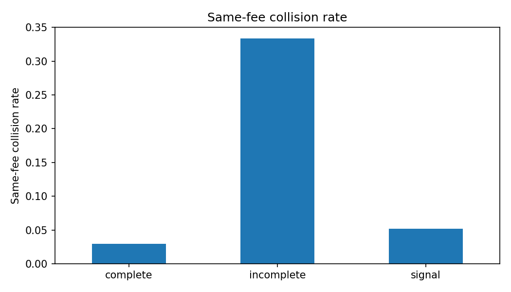 | 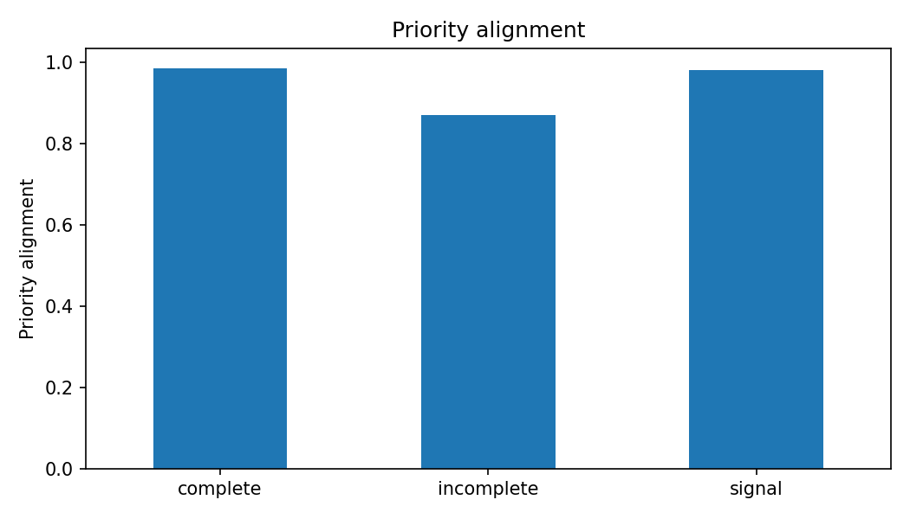 |
| **Fee expenditure** | **Mean waiting** |
| 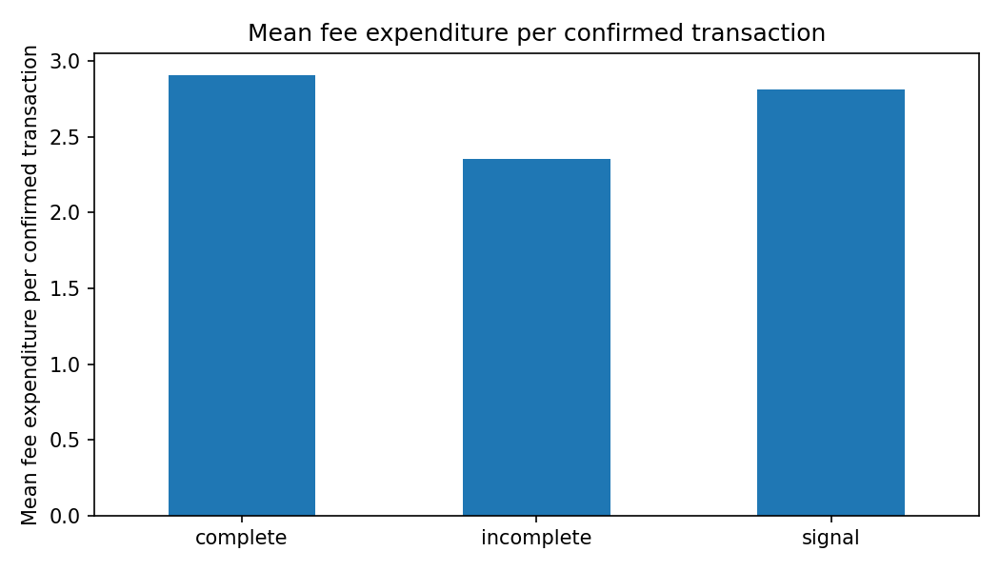 | 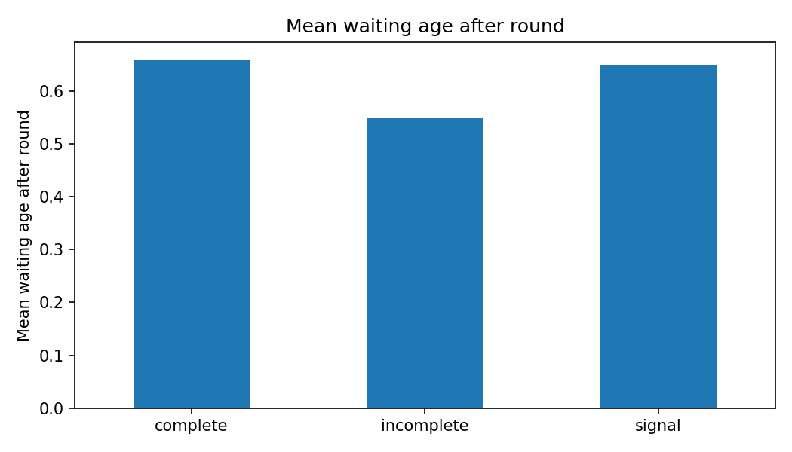 |
| **User welfare** | |
| 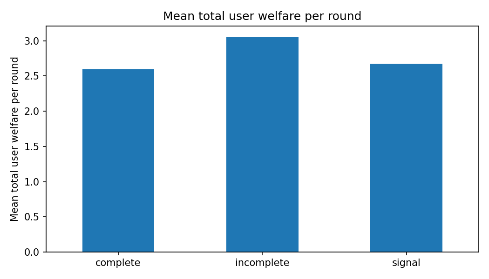 | |

### Round-by-round dynamics

| Condition | Round | Same fee | Alignment | Fee | Welfare | Waiting |
|---|---:|---:|---:|---:|---:|---:|
| Complete | 1 | 2.97% | 98.45% | 2.8024 | 3.3247 | 0.5000 |
| Complete | 2 | 2.85% | 98.50% | 2.9565 | 2.6916 | 0.7370 |
| Complete | 3 | 2.93% | 98.46% | 2.9563 | 1.7781 | 0.7403 |
| Incomplete | 1 | 50.46% | 96.99% | 1.8719 | 4.2279 | 0.5000 |
| Incomplete | 2 | 45.36% | 75.08% | 2.3791 | 2.5860 | 0.6237 |
| Incomplete | 3 | 4.25% | 96.59% | 2.8053 | 2.3570 | 0.5200 |
| Signal | 1 | 5.90% | 98.36% | 2.6633 | 3.4568 | 0.5000 |
| Signal | 2 | 3.90% | 97.71% | 2.8681 | 2.7567 | 0.7316 |
| Signal | 3 | 5.80% | 98.17% | 2.9055 | 1.8205 | 0.7176 |

Accumulated waiting changes the comparison policy: incomplete-information collisions fall sharply by the third round, while signal collisions stay relatively low. Fee expenditure and welfare also change with the waiting state.

| Collisions by round | Waiting by round |
|:---:|:---:|
| 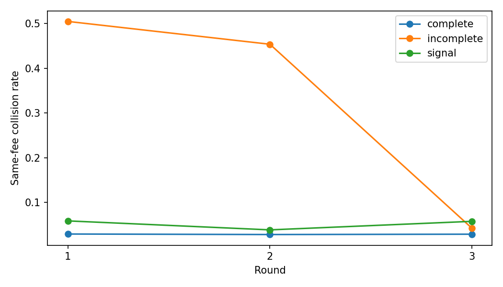 | 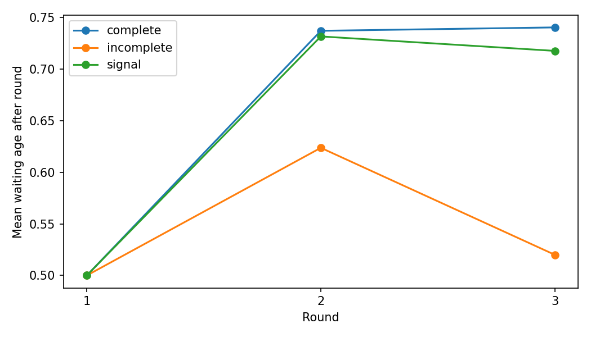 |

### Signal-following sensitivity

The notebook varies signal following from 0 to 1, with 30,000 three-round sessions per value. The full sweep shows the allocation–cost trade-off: higher following reduces collisions and improves alignment, but raises fees and waiting while lowering user welfare. Separate seeds explain small differences from the main baseline.

| Signal following | Same fee | Alignment | Fee | Welfare | Waiting |
|---:|---:|---:|---:|---:|---:|
| 0% | 33.32% | 87.15% | 2.3507 | 3.0569 | 0.5476 |
| 10% | 28.44% | 88.93% | 2.4058 | 3.0108 | 0.5612 |
| 20% | 23.96% | 90.50% | 2.4574 | 2.9627 | 0.5747 |
| 30% | 19.99% | 92.27% | 2.5074 | 2.9174 | 0.5892 |
| 40% | 16.34% | 93.74% | 2.5621 | 2.8846 | 0.6050 |
| 50% | 13.32% | 94.86% | 2.6121 | 2.8398 | 0.6139 |
| 60% | 10.60% | 95.97% | 2.6707 | 2.7941 | 0.6270 |
| 70% | 8.03% | 96.91% | 2.7275 | 2.7544 | 0.6378 |
| 80% | 5.98% | 97.70% | 2.7849 | 2.6999 | 0.6472 |
| 90% | 4.26% | 98.18% | 2.8444 | 2.6570 | 0.6542 |
| 100% | 3.02% | 98.54% | 2.9059 | 2.6081 | 0.6598 |

| Following rate: collisions | Following rate: alignment |
|:---:|:---:|
| 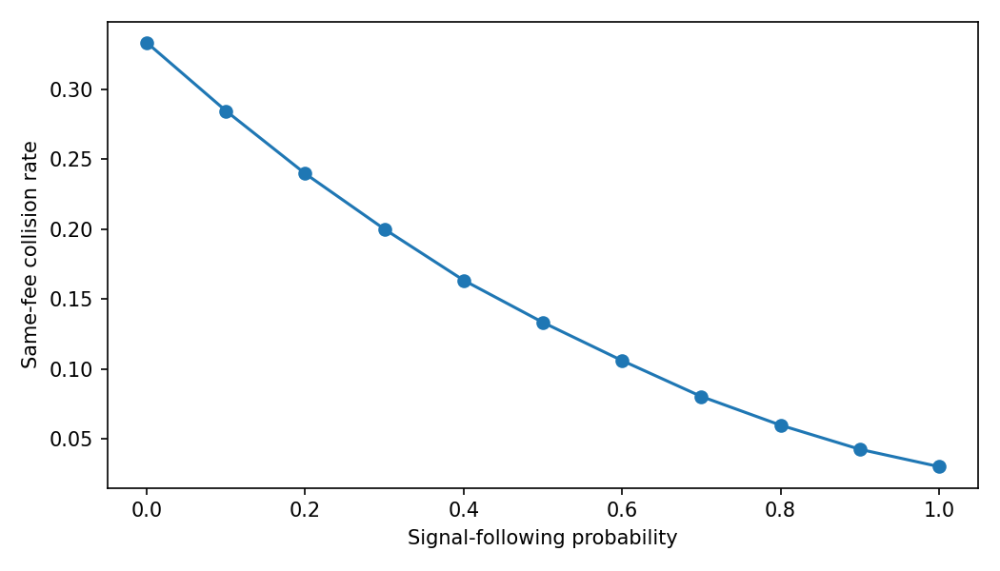 | 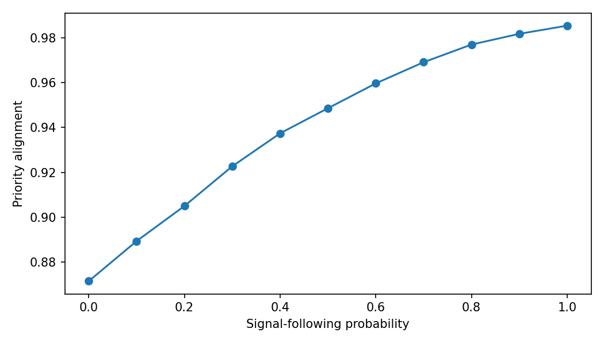 |
| **Following rate: fee expenditure** | **Following rate: user welfare** |
| 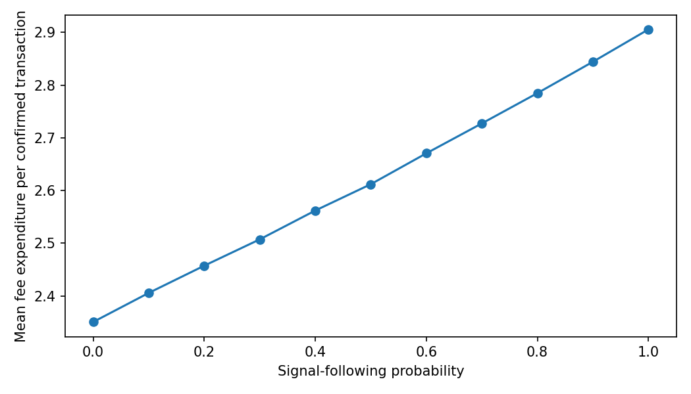 | 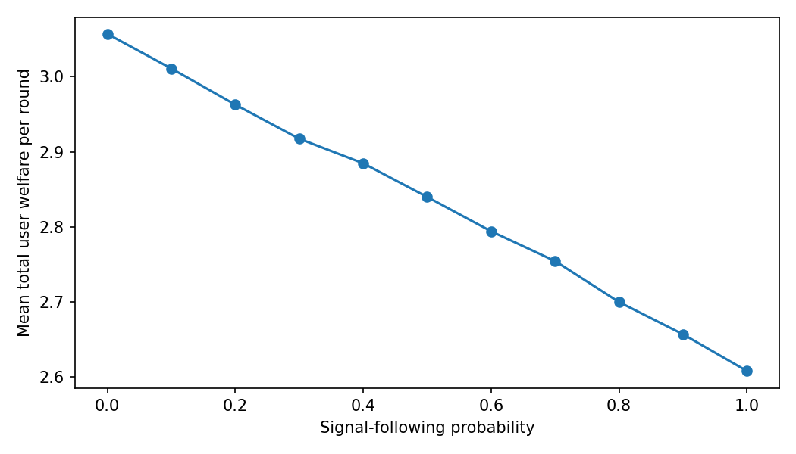 |

**Outputs corresponding to the poster:** the baseline table and linked plots above reproduce the current poster's quantitative comparison and allocation–cost interpretation. The CSVs retain the full-precision values behind the displayed rounding.

### Noisy urgency information

The [new notebook](notebooks/dynamic_fee_choice.ipynb) also tests imperfect information at the coordinator. Each user's observed urgency is independently flipped with probability 0%, 10%, or 20%, once per three-round session; true types still determine the fallback policy, payoffs, and evaluation. Signal following (0.85), tremble (0.03), and fee rules stay fixed, with 100,000 sessions per scenario.

| Urgency error | Same fee | Alignment | Urgent confirmed | Fee / confirmation | Welfare / round | Mean waiting |
|---:|---:|---:|---:|---:|---:|---:|
| 0% | 5.20% | 97.99% | 81.25% | 2.8123 | 2.6780 | 0.6497 |
| 10% | 5.87% | 86.36% | 75.39% | 2.8038 | 2.5383 | 0.6499 |
| 20% | 6.55% | 77.05% | 69.75% | 2.7952 | 2.4076 | 0.6492 |

These results were independently reproduced; the zero-error case matches the signal baseline exactly. At 10% error, alignment falls below the incomplete-information baseline (87.11%), while collisions remain low. Welfare falls despite slightly lower fees and nearly unchanged waiting. Error rates are experimental assumptions, not measured rates. [Full-precision noisy-urgency CSV](results/noisy_urgency_summary.csv). The plots below were regenerated by the local run.

| Priority alignment | Same-fee collisions |
|:---:|:---:|
| 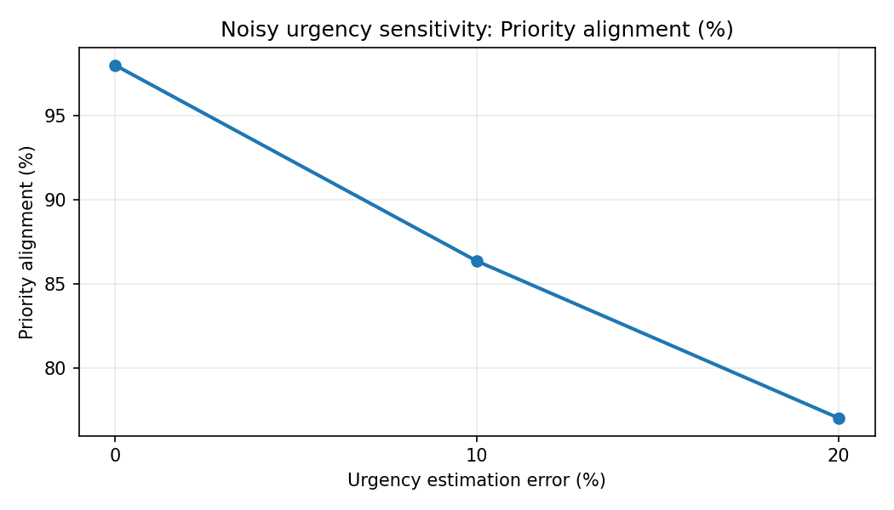 | 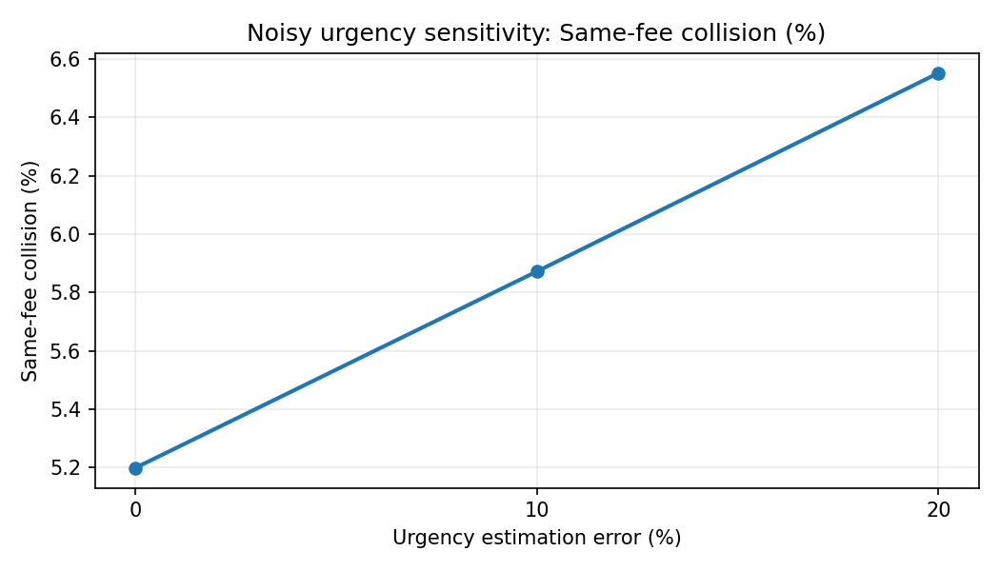 |
| **Fee expenditure** | **User welfare** |
| 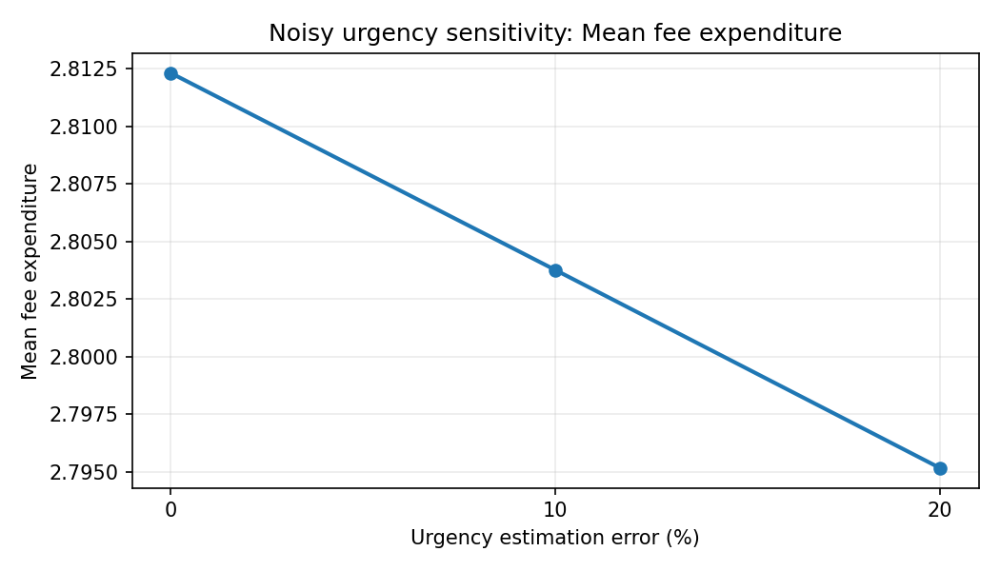 | 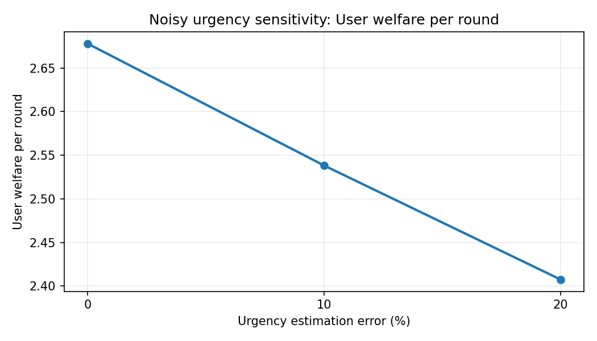 |
| **Mean waiting** | |
| 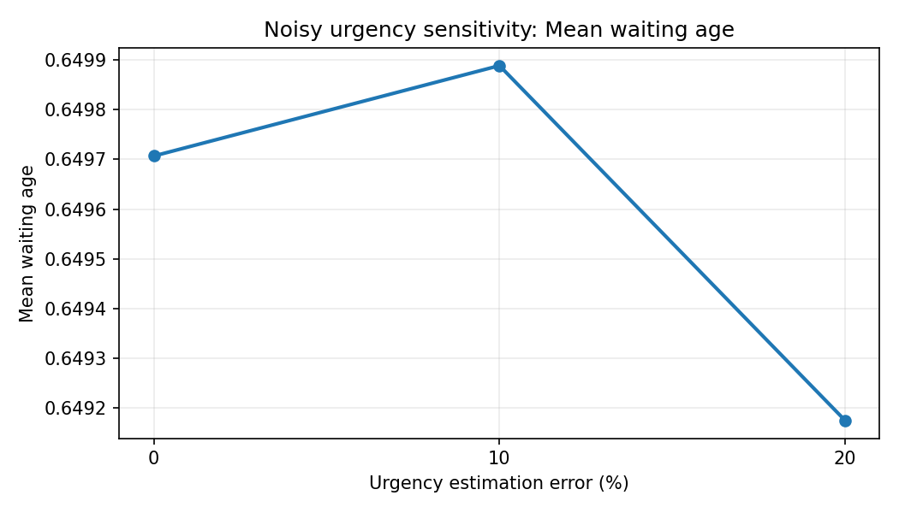 | |

## Tested version and run steps

**Tested baseline commit:** `726511c24480e1d95ed4a611672a214334679625`; its historical record is preserved in [the baseline manifest](results/baseline_run_manifest.json). The latest notebook was also rerun locally: all eighteen baseline and eighteen noisy-urgency aggregate values passed, the zero-error signal baseline matched exactly, and sixteen figures were generated. The [current run manifest](results/run_manifest.json) identifies the tested source by SHA-256; this local package has no new Git commit yet.

Current test environment: Python 3.13.1, NumPy 2.4.4, pandas 3.0.2, Matplotlib 3.10.8, IPython 9.15.0. Dependencies are pinned in `requirements.txt`.

From the repository root:

```bash
python3 -m venv .venv
source .venv/bin/activate
python -m pip install -r requirements.txt
python scripts/reproduce.py
```

The script executes all thirteen Python cells of `notebooks/dynamic_fee_choice.ipynb` unchanged, exports six CSVs and sixteen PNGs to `results/`, and saves `results/dynamic_fee_choice.executed.ipynb`. It checks the baseline and noisy-urgency aggregate results against the supplied outputs with absolute tolerance 0.000051, plus exact zero-noise agreement with tolerance 1e-12. A successful run ends with `PASS: baseline and noisy-urgency aggregates reproduced; 900,000 baseline rows; 900,000 noisy-urgency rows; 16 figures.` No Jupyter kernel or GPU is required.

For Colab, upload [`notebooks/dynamic_fee_choice.ipynb`](notebooks/dynamic_fee_choice.ipynb) and choose **Runtime → Run all**. The notebook exports the baseline, round, compliance, and noisy-urgency CSVs. The large `noisy_urgency_round_records.csv` is generated on demand and excluded from Git; download any files you need before ending the runtime. Live Colab sharing and the current Hugging Face revision were not independently verified in this session.

## Repository contents and evidence limits

- `assets/poster_preview.png`: preview rendered directly from the current A0 poster PDF.
- `poster/`: current A0 poster PDF.
- `assets/fee_choice_teaser.png`: current research-design diagram.
- `notebooks/dynamic_fee_choice.ipynb`: the current notebook, including all baseline and sensitivity experiments.
- `scripts/reproduce.py`: full-run exporter and comparison checks.
- `results/`: five aggregate CSVs, sixteen regenerated figures, the fresh executed notebook, and current/historical run manifests.
- `docs/`: artifact descriptions, reproduction details, evidence status, and the current research document.

The old notebook generator and validation script have been removed because they recreate or require the obsolete H/L model.

No participant dataset, live Algorand validation, or causal treatment estimate is included. The Hugging Face link is a behavioral interface, not evidence of measured human compliance.

## Authors and license

Lin Zhang (`lin.zhang@dukekunshan.edu.cn`) and Zijie Wang (`zijie.wang@dukekunshan.edu.cn`). Team 7, COMSCI/ECON 206: Computational Microeconomics; instructor Professor Luyao Zhang.

Original project code and documentation: MIT.
